# Praktikum 8 - PHP dan Database MySQL

Praktikum ini membahas pembuatan aplikasi web sederhana menggunakan PHP dan database MySQL. Aplikasi digunakan untuk mengelola data barang dengan fitur CRUD (Create, Read, Update, Delete).

## 1. Persiapan
Software yang digunakan:
- XAMPP
- Visual Studio Code
- Browser

Menjalankan Apache dan MySQL melalui XAMPP.

## 2. Membuat Database
Membuat database dengan nama `latihan1` melalui phpMyAdmin.

Kemudian membuat tabel `data_barang` dengan kolom:
- id_barang
- kategori
- nama
- gambar
- harga_beli
- harga_jual
- stok

## 3. Membuat Koneksi Database
Membuat file `koneksi.php` untuk menghubungkan PHP dengan database MySQL.

## 4. Menampilkan Data Barang (Read)
Membuat file `index.php` untuk menampilkan seluruh data barang dari database.

## 5. Menambah Data Barang (Create)
Membuat file `tambah.php` yang digunakan untuk menambahkan data barang baru, termasuk mengunggah gambar.

## 6. Mengubah Data Barang (Update)
Membuat file `ubah.php` untuk mengedit data barang yang sudah tersimpan.

## 7. Menghapus Data Barang (Delete)
Membuat file `hapus.php` untuk menghapus data barang berdasarkan ID.

## 8. Pengujian
Melakukan pengujian terhadap seluruh fitur CRUD:
- Menampilkan data barang.
- Menambahkan data barang.
- Mengubah data barang.
- Menghapus data barang.

## Kesimpulan
Praktikum ini menghasilkan aplikasi pengelolaan data barang sederhana menggunakan PHP dan MySQL. Aplikasi telah menerapkan fitur CRUD sehingga pengguna dapat menambah, melihat, mengubah, dan menghapus data barang.

## Lampiran 

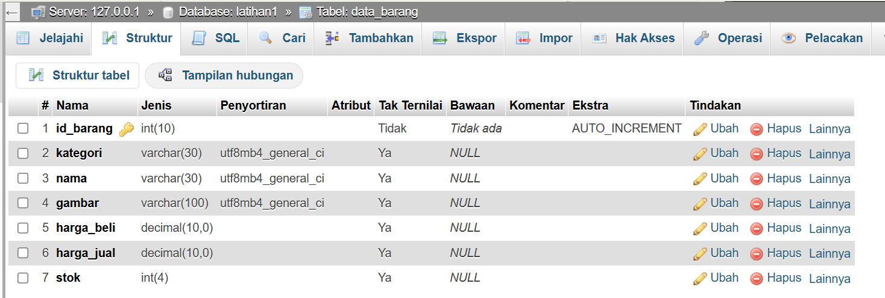
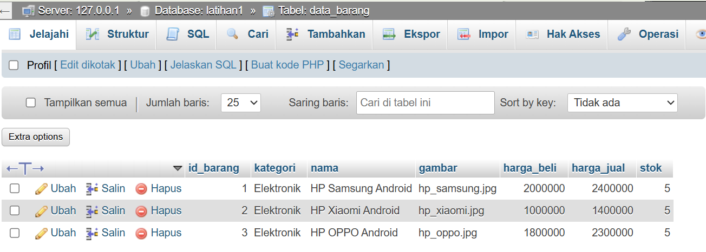
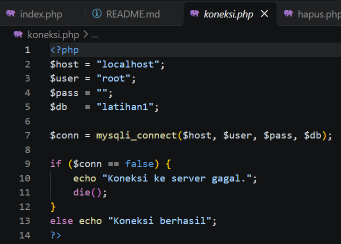
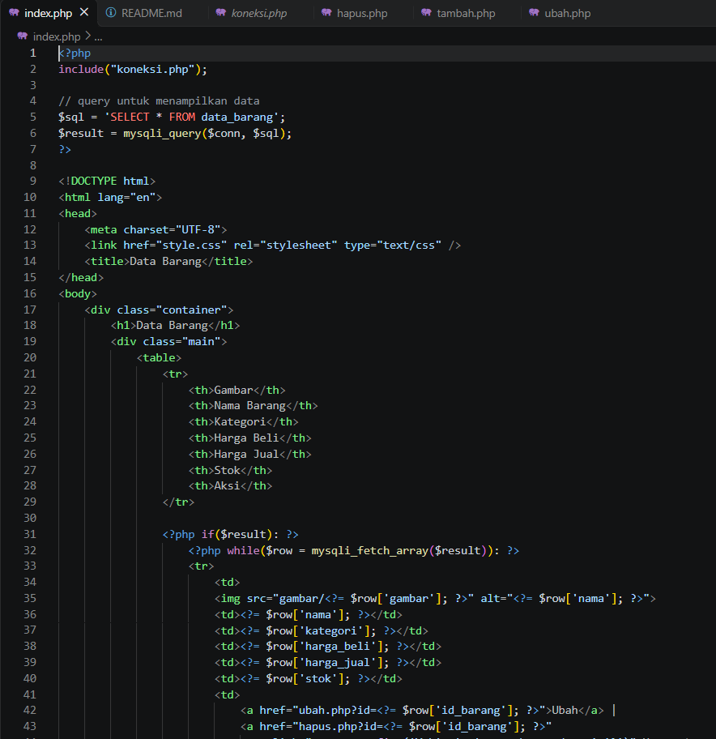
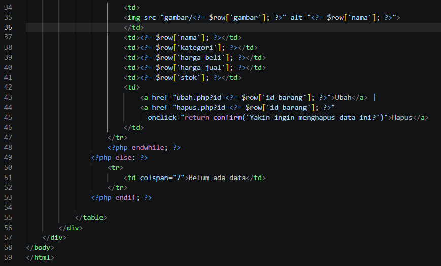
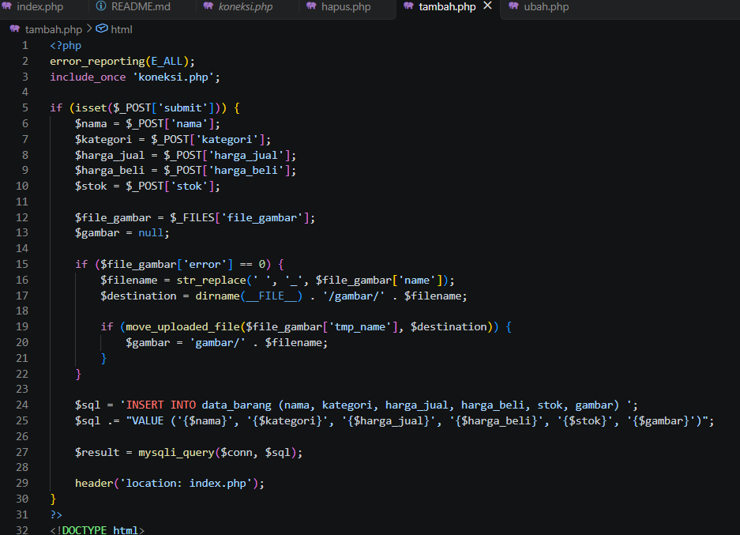
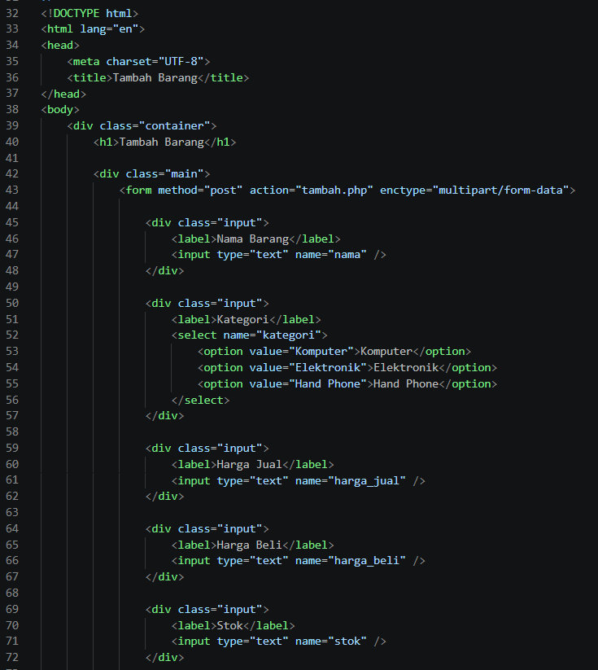
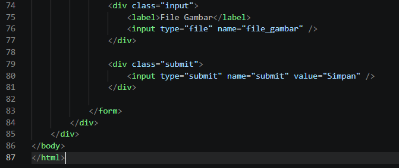
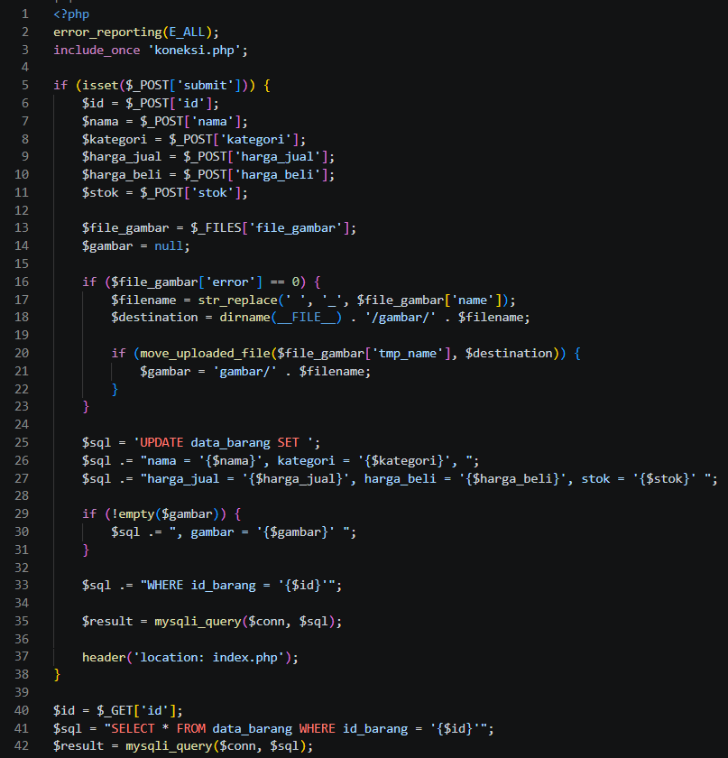
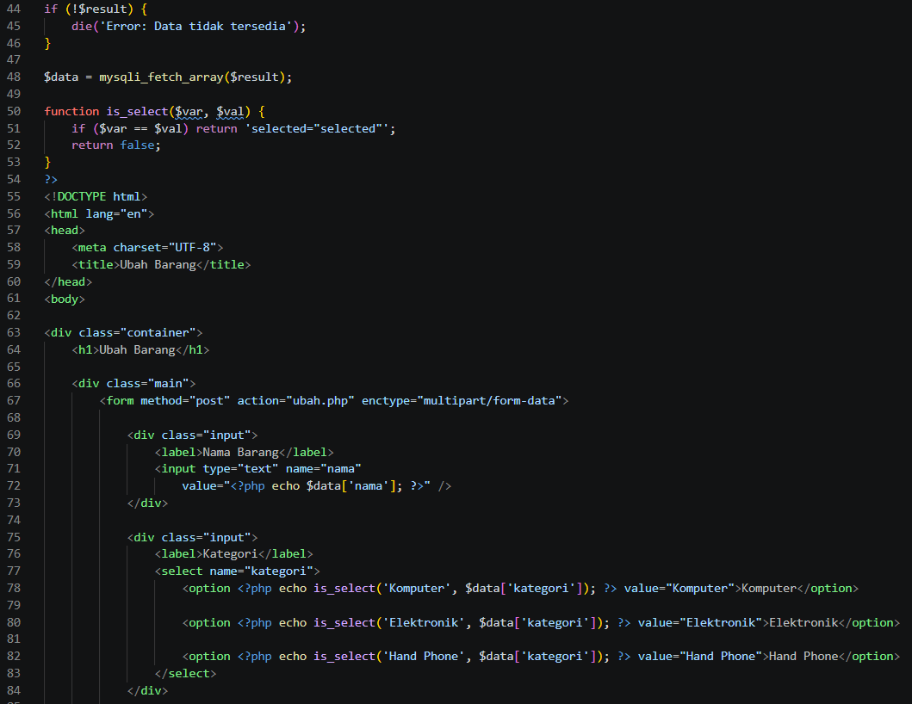
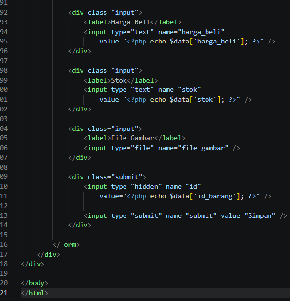
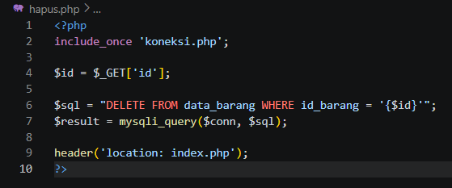

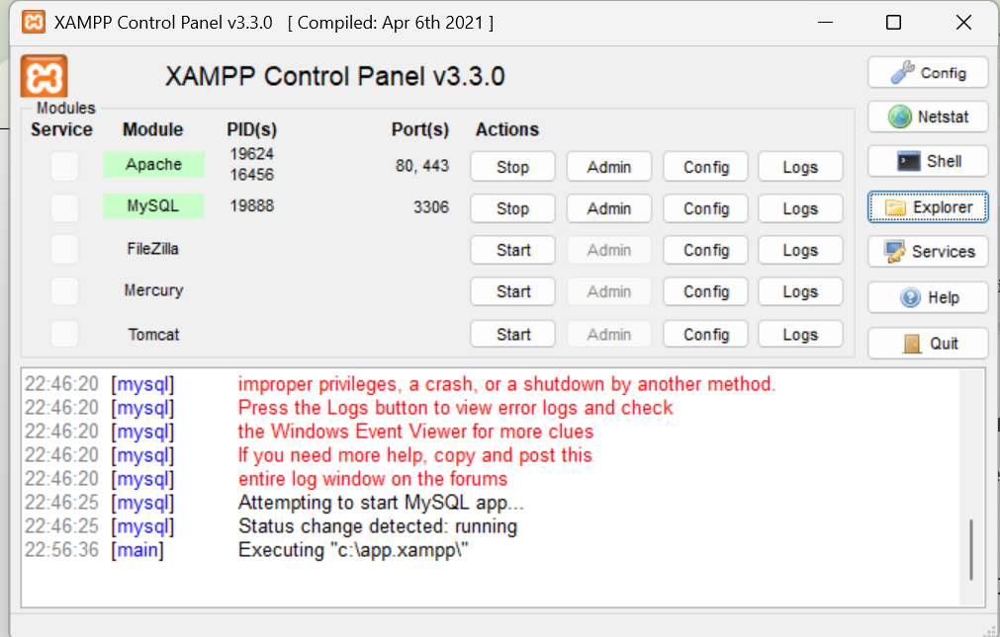
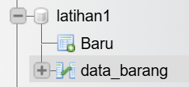
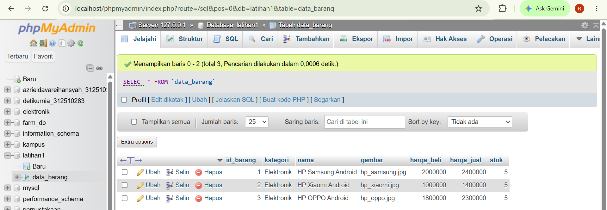
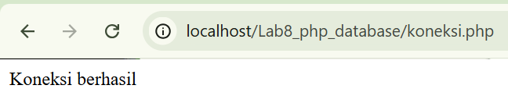
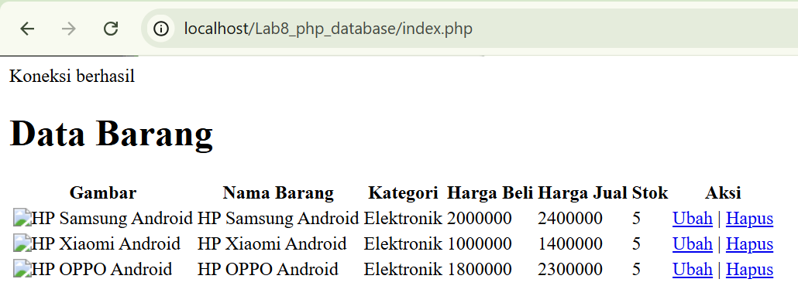
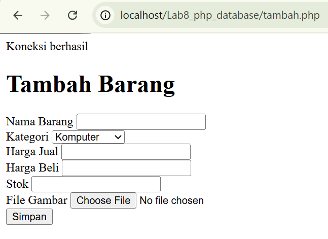
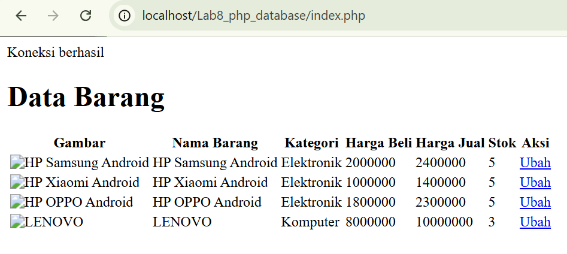
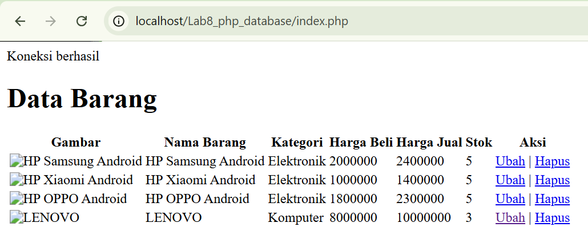